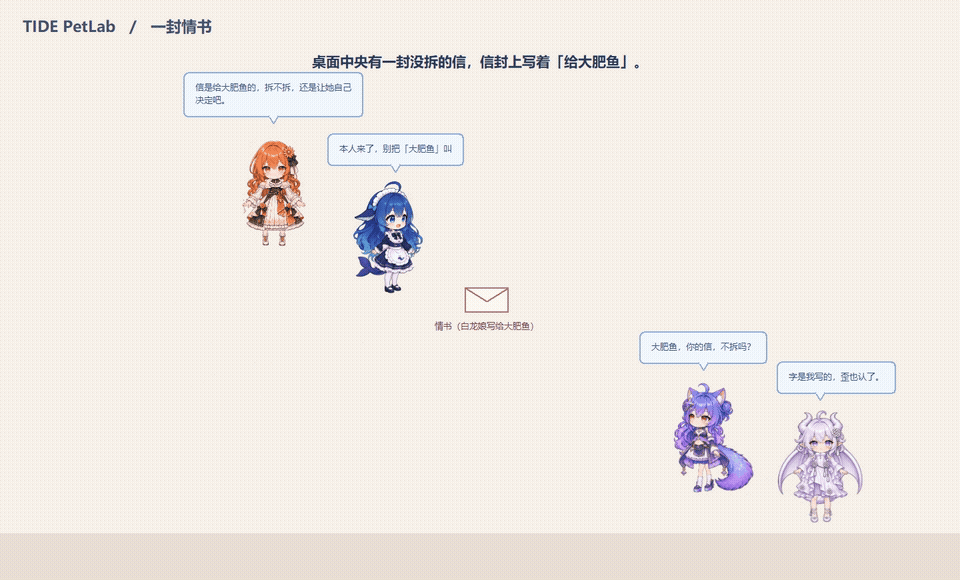

# TIDE PetLab

Four AI desktop companions with persistent memories, movement and conversations on Windows.

[中文](README.md) · [Download the Windows bundle](https://github.com/QAQdesuwawa/TIDE-Petlab/releases/tag/v0.1.0-alpha.529) · [Developer documentation (Chinese)](docs/developer/README.md)

*15 seconds of actual desktop footage recorded on November 24, 2026. The scene shows four characters moving, turning and talking around a letter.*

## Try the desktop companions

1. Download **TIDE-PetLab-alpha.529-win-x64-models.zip** from the linked release, approximately 1.44 GB.
2. Extract it into a new folder and double-click **START.cmd**.
3. Enter your model provider configuration in settings. **SETUP.cmd** opens setup.

The Windows x64 bundle includes Python/Tk and local retrieval models. A separate Python installation is unnecessary. Input measurement and dialogue generation use your configured model service, with charges set by that provider. This is a technical Alpha. See the release notes for launch and character configuration.

**The main source branch is ahead of the 529 bundle.** Recent delivery coverage and fair intake scheduling fixes are available in source. The downloadable bundle contains the implementation from its release.

## What it supports

- Four character personas, public conversations and proximity-dependent whispers.
- Movement toward companions and objects, obstacle avoidance and animated actions.
- Memories with source and time information, including earlier judgment and communication purpose.
- Asynchronous input measurement, dialogue generation and presentation.
- Character-by-character speech display and receipts for what was actually shown or executed.
- Player messages and dragging during interaction.

Replies, recalled experiences and selected actions depend on current input, state and model output. The clip shows one observed run.

## Build on the runtime

TIDE supplies interfaces for events, time, state, history influence, commits and recovery. PetLab connects them to desktop characters. CX67 supplies the character dynamics model.

An input model interprets incoming material. Deterministic algorithms compute state and eligibility. A Writer model produces character expression. Execution receipts establish what each recipient actually received and how far actions progressed, so later memory can retain those distinctions.

The source separates the runtime, domain models and product adapters. Start with the [developer guide](docs/developer/README.md), [standalone runtime](docs/developer/runtime.md) or [custom packages](docs/developer/packages.md). These detailed guides are currently in Chinese. The [architecture reference](README.architecture.zh-CN.md) preserves the extended technical explanation.

Recent queue fixes have offline replay and regression coverage. Long-running queue stability and real desktop response latency remain under evaluation.

See [LICENSE](LICENSE) for the code license and [ASSET_SOURCES.md](ASSET_SOURCES.md) for character artwork attribution.
