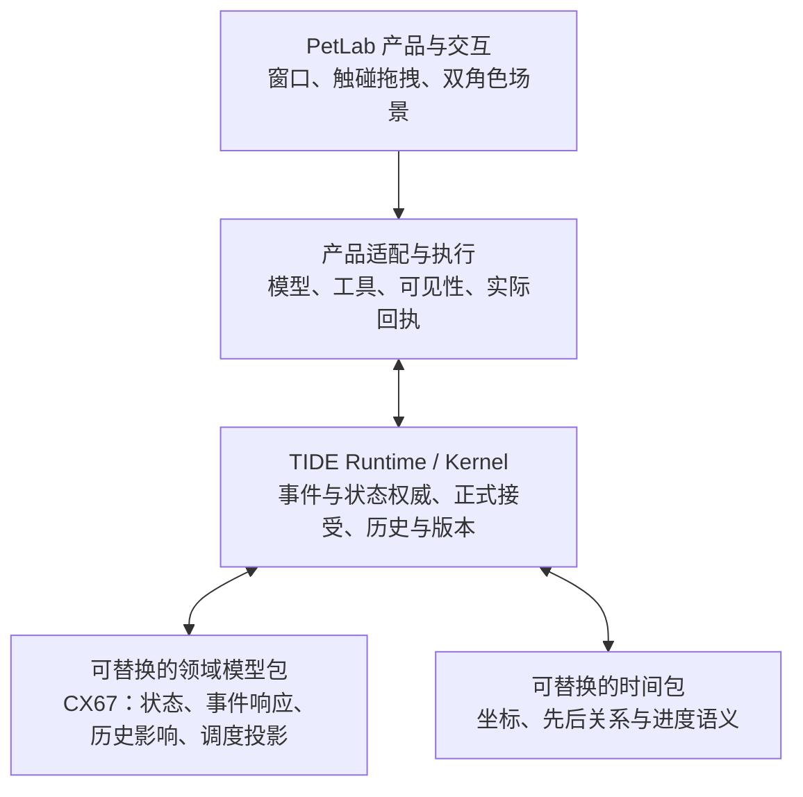

# TIDE · PetLab

**给持续运行的 AI 角色，一段可追溯的过去与一个可计算的现在。**

**记住过去，不等于过去真的会影响现在。** TIDE 把时间、事件、历史影响与状态演化组织进同一套可追溯的运行机制；PetLab 让这套机制以 Windows 双桌宠的形式运行起来。

**TIDE 是通用交互运行内核，CX67（六七包）是可替换的角色动力学领域模型，PetLab 是可直接体验的桌面应用。** 你可以只使用 PetLab，也可以仅复用 Runtime、模型包接口和时间包接口，接入自己的前端、模型或算法。

**项目状态：Windows 源码版 · 技术 Alpha。** 当前可运行的是双桌宠示例，不是免安装 EXE，也尚未开放产品界面的自定义角色创建。

[下载带模型的完整包](https://github.com/QAQdesuwawa/TIDE-Petlab/releases/tag/v0.1.0-alpha.492) · [开发者入口](docs/developer/README.md) · [社区介绍文案](docs/community.md)

## 现在能体验什么？

- **两只独立的桌面角色。** 新安装默认启动「大肥鱼」和「小肥鱼」；共用素材与 API 配置，但身份、关系状态和初始记忆独立。发行包不包含开发者私人聊天记录。
- **持续的桌面交互。** 可触碰、拖拽，角色具有本地反馈、可选讲话和自主活动；鼠标交互不会等待网络请求完成。
- **连续动作与实际交接。** 已接入玩尾巴、玩手机、看向和走近对方，以及吃饭、递碗与接受等动作。一次反应可以组织多个连续子动作；是否选中及实际完成到哪里分别留档，不保证每轮都会触发。
- **公开与私聊。** 可以对单只角色公开发言、同时对两只发言或进行私聊。另一角色仅在可见范围内接收事件，并依据自身状态决定是否回应。
- **带来源的经历。** 角色可以读取公开网页；成功的实际读取结果会保存并进入后续记忆处理。未读完的页面不会被标成全文已读。
- **跨次运行的延续。** 重新启动时恢复对应角色的本地存档、已提交历史及必要运行状态。

动作、表情、可选讲话和私有思考是同一父反应下的独立结果；可见内容按受众传递，私有思考留在角色自己的范围内。

这些是当前 Alpha 已有的功能范围；准确率、响应时间和召回效果受模型、机器和历史规模影响。完整边界见 [Alpha 验收范围](ALPHA_ACCEPTANCE.md)。

## 记忆怎样影响现在

普通的上下文摘要、向量检索和记忆卡都可以提供有用的历史信息，但**找到一条旧记录**与**让一次旧经历合法地影响当前状态**，是两个不同的问题。

TIDE 将这些职责拆开：

| 机制 | 实际解决的问题 |
| --- | --- |
| **正式状态接受** | 领域包计算候选，Runtime 验证绑定、来源与阶段后接受结果；模型草稿和界面预览不直接成为正式状态。 |
| **已提交历史与来源** | 哪些事件真正成立？谁说的、什么时候发生、属于哪个版本？ |
| **记忆内容检索** | 当前需要读取哪些原文？可通过本地 Embedding、Reranker 和来源地址找到对应材料。 |
| **前向历史影响** | 某次实际召回怎样经已提交的有向关系参与后续状态，而不回改旧事实？ |
| **时间与事件结算** | 角色在无新消息的时间里如何演化？新事件又如何改变当前状态？ |
| **操作与语义分责** | 哪些行动具有执行资格？模型能怎样表达？候选与真实结果怎样区分？ |
| **版本化与回放** | 发生错误时，怎样根据当时的输入、版本和回执核对运行过程？ |

**历史保留原始来源，不以不断覆盖的摘要作为唯一历史。** 生成模型也不会每轮接收所有历史，而是读取当轮获得资格的材料。这里的“有向因果关系”指已记录的执行依赖与来源，不等于自动证明现实世界的因果效应。

内容检索命中、数值召回、状态影响和模型采用分别留档。一条记录在内容上相似，并不自动赋予它改变当前状态的资格。

### CX67：角色如何随互动变化

CX67 是 TIDE 上的一种**心理学启发的互动动力学模型**，不是人脑复刻，也不是临床人格诊断：

- 支持按五类原型图式组合生成**七个角色常量**，描述不同角色相对稳定的反应敏感度；
- 使用 **六维有界连续状态** `X ∈ [0, 1]^6`，分别表达互动压力、需求、靠近与排斥、双方信息量；
- 让事件响应、真实时间流逝、符合规则的历史影响，共同参与状态结算；
- 从同源状态形成观察节律、主动开口资格和语义表达条件，自主开口沿 dynamic Tick 采样，是否发送仍需经过资格判断；界面和模型完成时刻不反过来决定根状态。

这些定义参与实际算子与状态读数，角色差异会延续到后续互动。它们是一套有限维计算近似，其现实心理学解释力仍需要独立研究验证。其他领域模型可以使用自己的状态维度与参数。

### 三层关系



Kernel 与领域包通过生命周期接口协作；领域包提供候选计算，Kernel 正式接受，宿主负责真实时钟、存储与外部执行。包和界面不直接覆盖已接受状态或历史。

## 立即运行 PetLab

**系统要求：** Windows 10/11、64 位 Python 3.11（包含 Tcl/Tk）、可写目录以及兼容的模型 API。

1. 下载[带模型的完整包](https://github.com/QAQdesuwawa/TIDE-Petlab/releases/tag/v0.1.0-alpha.492)，解压到较短的可写目录，例如 `D:\PetLab\`。
2. 双击 **`START.cmd`**。首次启动会安装 Python 依赖。完整包已包含本地检索模型和 CPU 运行时；若下载源码 ZIP 或克隆仓库，首次启动会自动下载固定版本资源（约 **1.3 GB**，支持断点续下；后续复用）。不需要管理员权限。
3. 在设置窗口的 **「模型」** 页面填写自己的 API 密钥，点击 **「保存并启动」**。默认使用 `deepseek-flash`；「表达模型」留空时与量测共用同一个模型。

兼容 Chat Completions 的其他提供方可填写完整接口地址与模型名称，接口需支持结构化 JSON 输出。网页读取默认使用 DeepSeek 官方接口的已有 Fetch 工具；其他提供方如需该能力，须配置相应工具适配器。

**修改 API 设置：** 双击 `SETUP.cmd`。可选的本机保存使用 Windows 当前用户加密；默认密钥只用于本次运行，不写入角色配置 JSON。

**恢复与隐私：** 本地数据默认位于 `output` 目录。旧单宠／旧双宠记录会按既有身份恢复，不自动覆盖或重建。要另开默认双宠，可运行 `.venv/Scripts/python.exe -m petlab_app --dual --setup` 并选择新的存档目录；原记录保持原样。备份范围见 [PRIVACY.md](PRIVACY.md)。

**升级与可选操作：** 旧包没有 `SETUP.cmd` 时可运行 `powershell -ExecutionPolicy Bypass -File .\quickstart.ps1 -Setup`。安装后可用 `.venv/Scripts/python.exe -B check_install.py` 离线检查。可选登录自启：`powershell -ExecutionPolicy Bypass -File configure_startup.ps1 -Enable`，使用 `-Disable` 撤销；移动目录后需要重新设置。真实 Windows 重新登录场景仍待进一步反馈。

## 给希望接入自己作品的开发者

你**不需要保留鲸鱼娘、Windows 窗口或六七模型包**，也能复用 TIDE 的 Runtime 与领域接口。

从 [开发者入口](docs/developer/README.md) 开始。可分别阅读 [开发自己的领域包](docs/developer/packages.md) 与 [桌宠适配](docs/developer/desktop.md)。已有三个离线示例，均不需要 API、桌面窗口或额外模型下载（运行前按开发者说明安装源码依赖）：

```powershell
python -B -m examples.runtime_minimal
python -B -m examples.existing_provider
python -B -m examples.existing_player
python -B -m unittest examples.test_examples
```

代码职责大致如下：

| 目录 | 作用 |
| --- | --- |
| `framework/` | 运行事务、正式历史、时间与生命周期、提交和恢复 |
| `model_packages/` | 具体状态空间、算子、召回规则与表达控制 |
| `product_adapters/` | 领域与实际产品、工具、模型服务之间的适配 |
| `petlab_app/` | Windows 双宠界面、动作、动画与执行回执 |

第一版产品尚未提供“无代码创建任意角色”的 UI。开发者可以通过领域包接口扩展，但仍须自行定义对应领域的状态与参数。

## Alpha 已知限制

- **当前仅提供默认双宠示例。** 自定义角色创建、背景生成、角色参数编辑、更多角色和外部聊天历史导入尚未开放。
- **不是免安装 EXE。** 当前是 Windows Python 源码发行版；本地检索使用 Qwen3-Embedding-0.6B Q8 与 Qwen3-Reranker-0.6B Q8，通过 CPU 运行，无需第二份 API 密钥或 GPU。
- **模型输出并非始终可靠。** 可能存在重复、归属误判、召回未命中或延迟；本地文字检索有约 500ms 预算，超时会留下真实状态，但不保证当前回复必然带回网页内容。
- **网页读取处理文本。** 当前不包含视频音画理解。
- **网页有读取边界。** 单次送入正文最多 4096 字符；长页面会注明只读取了开头。网页原件与回执保存在存档旁的 `.resources` 中；失败不会记录为成功。
- **大存档恢复可能较慢。** 首次恢复可能超过一分钟，具体随历史规模和机器条件变化。

详细验收范围和版本见 [ALPHA_ACCEPTANCE.md](ALPHA_ACCEPTANCE.md) 与 [VERSION](VERSION)。

## 隐私、素材与许可

文字、交互摘要以及选中的角色和记忆材料会发送给你配置的模型服务提供方，并产生相应 API 费用。本地存档与回执属于私人数据，**请勿把 `output`、API 密钥、私人配置或包含敏感信息的截图上传到公共仓库**。备份与数据说明见 [PRIVACY.md](PRIVACY.md)。

源码当前按 [AGPL-3.0](LICENSE) 声明；本地模型权重及 `llama.cpp` 分别遵守各自许可证，详见 [LOCAL_MODELS.md](LOCAL_MODELS.md)。第三方图片不自动继承源码许可，素材来源和许可状态见 [ASSET_SOURCES.md](ASSET_SOURCES.md)。

