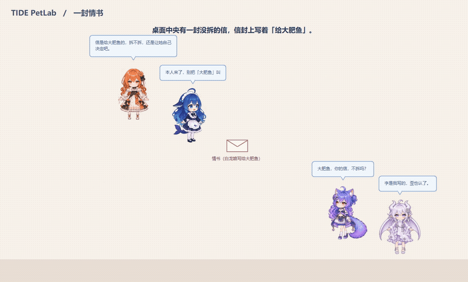

# TIDE PetLab

四个有记忆的 AI 桌宠，在你的 Windows 桌面上相遇、聊天、走动和互动。

[English](README.en.md) · [下载 Windows 完整包](https://github.com/QAQdesuwawa/TIDE-Petlab/releases/tag/v0.1.0-alpha.529) · [开发者文档](docs/developer/README.md)

*15 秒实机片段，录于 2026-11-24。展示四角色围绕情书走动、转身和对话。*

## 想先玩一下

1. 打开上面的下载页，下载 **TIDE-PetLab-alpha.529-win-x64-models.zip**，约 1.44 GB。
2. 解压到一个新文件夹，双击 **START.cmd**。
3. 在模型设置中填写自己的 API 配置。可以通过 **SETUP.cmd** 打开设置。

完整包带有 Python/Tk 运行时和本地检索模型，无需先安装 Python。角色量测和台词生成使用配置的模型服务，API 费用由服务商收取。Windows x64 技术 Alpha，启动方式和角色配置详见下载页。

**源码 main 比 529 下载包更新。** 最近的收件覆盖与公平排序修复已进入源码，完整包仍对应 529 发布时的功能。

## 它们能做什么

- 四个不同人设的角色可以互相说话，收到公开对话或符合距离要求的私语。
- 角色可以走近物件和同伴、绕开占地，使用已有动画表达动作。
- 实际经历会保留来源和时间，后续召回可带入判断依据与表达目的。
- 量测、台词生成和播放可以异步衔接。逐字显示留下已播内容，打断按实际执行范围结算。
- 玩家可以聊天、拖拽角色，观察环境和同伴反馈怎样影响下一步。

角色是否接话、回忆或选择某个动作，由当时输入、状态和模型输出共同决定。录像展示的是一段实际运行结果。

## 想接入自己的 Agent

TIDE 提供事件、时间、状态、历史影响、提交和恢复接口。PetLab 将这些接口接到 Windows 桌面角色，CX67 提供角色动力学模型。

量测模型处理输入，中间算法计算状态与资格，Writer 组织角色表达。实际播放回执保留谁听见了什么、动作执行到了哪里，以及哪些内容进入了后续记忆。

- [开发者入口](docs/developer/README.md)
- [独立 Runtime](docs/developer/runtime.md)
- [自定义领域包](docs/developer/packages.md)
- [架构与历史技术说明](README.architecture.zh-CN.md)
- [旧聊天导入](docs/user/import-chat.md)

最近的收件修复通过了离线回放和回归测试。持续运行的队列稳定性、实机首字延迟仍需要进一步测量。

代码许可见 [LICENSE](LICENSE)，角色素材来源见 [ASSET_SOURCES.md](ASSET_SOURCES.md)。
