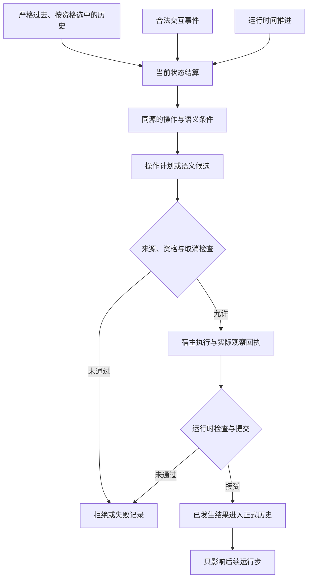
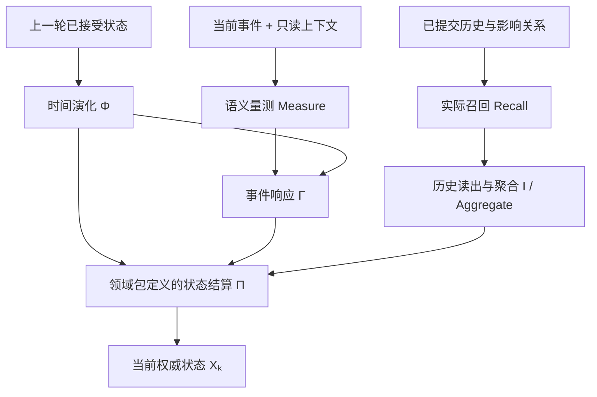
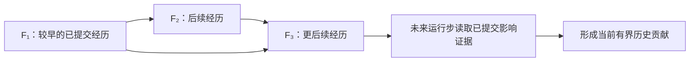
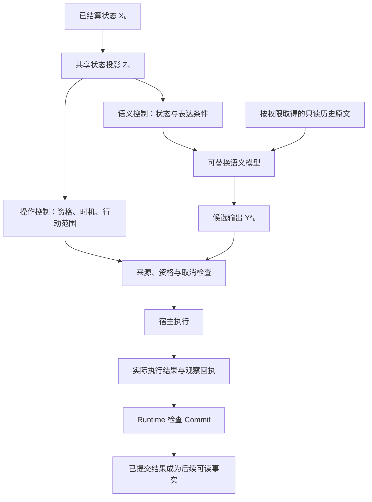

# TIDE

持续交互 Agent 的时序运行内核 · PetLab 双桌宠应用示例

> **给持续运行的 AI，一段可追溯的过去、一个可计算的现在。**
>
> **记住过去，不等于过去真正影响了现在。**

**TIDE（Temporal Interaction Dynamics Engine）** 是一套面向持续交互 Agent 的**时序运行内核**。它将事件、真实时间、历史影响、状态演化与事实提交组织为同一套有来源、可追溯、可复核的运行过程。

它不只是一个 RAG 记忆插件，也不要求把越来越长的聊天记录反复压缩成唯一的一篇摘要：**已提交的经历保留原始来源，历史按需寻址；实际唤起的历史可以在领域模型的约束下参与状态计算，而不必每次把全部过去塞进提示词。**

- **TIDE Runtime**：通用内核，负责事件与时间、状态权威、提交、历史、版本和恢复。
- **CX67（六七包）**：可替换的角色动力学模型，用七个角色常量和六维互动状态构建一种心理学启发的计算近似。
- **PetLab**：Windows 双桌宠示例，把内核放进实际可见、可交互的场景。**桌宠只是应用之一，不是 TIDE 的边界。**

*Persistent AI agent runtime · Event-sourced history · Temporal state dynamics · Forward memory influence · Pluggable interaction models*

**当前提供：框架的 Python 源码接口，以及 PetLab 的 Windows 技术 Alpha。** 框架的独立示例不依赖桌面窗口或本地模型；桌宠应用尚非免安装 EXE，当前源码提供独立角色创建页，旧 Release 仍以其版本说明为准。

[**开发者快速入口**](docs/developer/README.md) · [**自定义领域包**](docs/developer/packages.md) · [**独立 Runtime**](docs/developer/runtime.md) · [**旧聊天导入**](docs/user/import-chat.md) · [**PetLab 示例下载**](https://github.com/QAQdesuwawa/TIDE-Petlab/releases/tag/v0.1.0-alpha.492)

---

## 为什么要做一套交互内核？

现在的 Agent 已经能够聊天、用工具、检索记忆。真正困难的是：**它怎样跨越许多次模型调用，持续维持一套一致的时间、状态和事实？**

找到一条旧记录、真的在本轮唤起它、让它影响当前状态、把原文交给模型、把新行为记成事实——**这些并不是同一个动作，也不应该由同一个相似度分数决定。**

| 常见的简化处理方式 | TIDE 额外明确了什么 |
| --- | --- |
| 对话太长，就继续摘要或截断 | **正式历史与当前上下文分离**：保留已提交记录，按需选择并交付原文；摘要可以作为派生材料，不替代历史底账。 |
| 检索到记忆，就把它塞进提示词 | **正文检索与历史状态影响分离**：文本相关，不等于具有修改状态的资格。 |
| 把“人物现在怎样”交给模型临场判断 | **领域状态与演化算子**：事件、时间和合格历史在正式结算中共同产生当前状态。 |
| 模型说了、工具尝试了，就认为事情发生了 | **候选／执行／正式事实分离**：实际回执、提交资格和后续可读历史有明确边界。 |
| 运行一段时间后，只剩最新的人设或摘要 | **来源、版本与回放**：保留当时使用的输入、模型包、参数和已接受结果，不静默重解释过去。 |

这是一种**运行时语义与职责划分**，不是对所有其他记忆框架的概括。TIDE 也不承诺大模型永远理解正确；它让系统可以分清：错误发生在量测、检索、状态结算、表达，还是实际执行与提交。

## TIDE 内核：四个相互连接的机制

以下四张示意图展示的是**同一条数据链的四个视角**，不是四套互不相干的系统。不同领域的具体状态空间和公式可以更换，但运行时的时间、来源、提交与权限边界保持明确。

### ① 完整运行步：从事件到未来可读的事实



每一轮先消费**合法事件、严格过去的历史和已验证的时间推进**，形成已结算状态，再决定是否执行操作或生成候选。**模型完成一次输出，不等于它已经成为事实；当前新提交的记录也不能倒过来参与产生它的那次结算。**

某次运行也可以只完成状态结算而不产生新的对外发言。后续生成或工具执行失败，不意味着可以回头抹掉已经正式接受的状态。外部执行一旦产生实际效果，提交失败也不能把它当成没有发生；宿主需保留实际回执，按来源和恢复协议继续处理。

### ② 三路结算：事件、时间与历史共同构成现在

下图用 CX67 一类连续状态领域模型说明三路贡献。`Φ`、`Γ`、`Π` 是领域算子的示意记号，具体计算、组合顺序与取值约束由版本化模型包定义；它们不是通用 Kernel 强制采用的统一公式。



同一评价时刻、同一版本绑定下，时间先形成事件前状态；当前事件与实际历史影响再参与统一结算。语义模型负责**量测**，领域包负责定义与计算演化算子，Runtime 负责正式接受状态。临时中间结果不能绕过这条链直接写入权威状态。

```text
X⁻ₖ = Φ(Xₖ₋₁, Δτₖ)              # 时间推进
uₖ  = Γ(X⁻ₖ, mₖ)                # 当前事件贡献
hₖ  = Aggregate(实际召回的历史影响) # 合法过去的贡献
Xₖ  = Π(X⁻ₖ, uₖ, hₖ)            # 正式状态结算
```

这一结构不仅适用于人格模型。领域包可以声明自己的连续状态、离散状态、符号关系或其他合法表示。

### ③ 前向记忆影响：保存发生过的事，也保存它后来怎样起作用



- **原始事实不可变**：记录具有身份、来源、当时的量测与版本绑定；后来的理解不能覆盖它当时的内容。
- **影响只向未来追加**：真实发生并获准的后续唤起，可以产生新的前向影响关系。
- **不同真实路径可以共存**：`F₁ → F₃` 与 `F₁ → F₂ → F₃` 不必因为共享祖先而被抹平；同一实际边的重复遍历也不能重复计数。
- **计算不等于无限展开路径**：已有历史影响可以复用，领域包负责定义实际读出与有界聚合；不需要把全部历史路径复制进每轮提示词。

这里的“有向因果”指**已记录的执行依赖与来源关系**，不是凭模型的语义联想认定现实世界的因果，也不是声称已经证明了心理学因果效应。

### ④ 一份状态，两条消费路径：行动与表达分责



**是否有资格行动**与**怎样表达一次行动或反应**读取的是同一个已结算上游，但各有职责。生成模型可以组织自然语言和候选动作；它不因此取得修改历史、重算状态或自行触发正式发送的权限。宿主执行过什么，则由实际回执说明。语言实现器可选：不需要讲话时，可以只执行合法动作或其他本地表现，仍沿同一回执与归档通路。上图中的共享投影由所选领域包提供，具体控制项按能力声明装配。

### 内核要维持的运行边界

| 约束 | 简单说 |
| --- | --- |
| 单调时间 | 后来的事务不能重排已接受的时间顺序。 |
| 状态权威 | 只有经过 Runtime 授权的转移才成为正式状态。 |
| 候选与事实分离 | 草稿、模型输出和 UI 预览不会自动变成历史事实。 |
| 只追加历史 | 旧事实与其版本绑定不被后续事务悄悄覆盖。 |
| 前向影响 | 旧经历可以影响以后，当前新事实不能反过来影响自身的产生。 |
| 版本化回放 | 使用保存的量测、候选、观察与版本核对历史，不要求重新生成完全相同的模型 token。 |

这里强调的**稳定性**是运行规则的可检查性、状态与历史边界的一致性，以及故障后可追溯、可恢复的基础；不是“永不出错”“所有任务都更准确”或“零延迟”。

## 长期记忆：不把“存档”和“塞进上下文”混为一谈

**TIDE 不以不断覆盖的摘要作为唯一长期历史。**一条正式记录可以保留原文、来源、时间、结构化量测和当时的版本证据。后续可以建立索引、结构化视图或派生摘要，但不必为了腾出模型窗口而抹去原始依据。

真正进入某次模型调用的材料则是**有界的、按需选择的视图**。这并不表示从来不做分块、摘要或截取，而是把这些处理限制在**索引、检索和交付**层面，不让它们冒充或替代原始正式历史。

当前 PetLab 的记忆使用至少有两条不同路径：

| 路径 | 负责什么 | 不负责什么 |
| --- | --- | --- |
| **正式数值召回／历史影响** | 按 CX67 及其显式版本的规则判断实际唤起，读取过去的 live influence 并参加后续状态结算 | 不因为文本相似度高就直接改写六维状态 |
| **本地 Embedding＋Reranker 正文检索** | 从已提交、当前可见的材料中寻找相关原文，并依来源地址水合交付 | 不自动形成正式数值召回，也不直接授予状态或发送权限 |

实际阅读网页等操作还会产生有来源的外部观察，后续可以沿合法关联取回**真正读到的内容**，而不是只拿到“曾经打开网页”的动作描述。当前会话也允许有界前文作为只读背景，但它不会自动取代正式记忆影响链。

换句话说：**保存什么、找到什么、真正唤起什么、数值上影响什么、模型最后看见什么，是可以分别核对的。**这也让记忆遗漏能够被定位到具体环节，而不只是笼统归因于“模型忘了”。

## CX67：可计算的角色互动近似，而不只是人设提示词

**CX67（六七包）是 TIDE 的一个领域模型实例，不是通用 Kernel 的硬编码人格。**它将心理学启发的角色差异落实为可计算的参数、状态与反馈关系：

- **七个角色常量** `C = (a1, a2, b1, b2, b3, g1, g2)`：支持由五类原型图式的权重构造，表达角色相对稳定的反应敏感度；当前桌宠使用预置模板中的常量。
- **六维有界状态** `X ∈ [0,1]^6`：表达当前关系中的压力、双方信息持有、未满足需求、正向牵引和防御／排斥。
- **事件响应与时间流**：相同事件可因角色常量不同产生不同响应；部分状态随真实时间向平衡点演化，信息轴不因普通沉默自动遗忘。
- **历史前向影响**：过去经历在明确的召回与读出规则下影响当前，而不是让模型临场“自由补一个心理变化”。
- **同源控制**：观察节律、主动开口资格与表达条件由已结算状态派生，不各自建立一套互相矛盾的人设判定。

这是一种**有限维、有界连续状态空间中的互动心理计算近似**，不是复刻人脑、临床人格诊断或已经验证的人类心理定律。开发者可以更换 CX67，使用完全不同的领域状态和动力学。

## 作为内核接入自己的作品

**可以单独复用 Runtime，接入自己的领域模型、前端和执行器。**现有目录和扩展入口按职责拆分：

| 路径 | 用途 |
| --- | --- |
| `framework/` | 通用时间、事件、事务、已提交历史、状态权威、提交和恢复 |
| `model_packages/` | 各领域自己的状态、演化、召回、投影和行动资格规则 |
| `product_adapters/` | 宿主、模型服务、工具和领域计算之间的适配 |
| `petlab_app/` | Windows 双桌宠、窗口、动作与实际执行回执 |

**开发者入口：**[接入已有项目](docs/developer/README.md) · [编写领域包](docs/developer/packages.md) · [桌面产品适配](docs/developer/desktop.md)

在源码根目录使用 Python 3.11 可直接运行以下**离线示例**。这几个示例只用标准库，不需要 API、模型下载或桌面窗口；完整产品的依赖安装见开发者指南。

```powershell
python -B -m examples.runtime_minimal
python -B -m examples.existing_provider
python -B -m examples.existing_player
python -B -m unittest examples.test_examples
```

接入已有 Agent 宿主时，需按合同适配输入、状态与实际执行回执。模型包声明 schema、能力和阶段实现，时间包声明坐标与进度，宿主提供时钟、存储和外部权限；现有 Runtime 装配入口负责绑定和校验。

## PetLab：内核的一个 Windows 桌面切面

PetLab 用户可从 [创建自己的角色教程](docs/user/characters.md) 进入：填写人设、量测生成参数、独立保存与恢复；首版复用现有鲸鱼动画。

PetLab 用两只默认角色「大肥鱼」「小肥鱼」展示这套机制。当前 Alpha 支持触碰与拖拽、主动活动、公开／私聊、双角色独立身份与记忆、部分连续身体动作，以及公开网页的读取与后续有源记忆交付。角色共享素材和 API 配置，但各自的身份、状态与可见经历独立；重新启动后可以恢复对应存档。**发行包不包含开发者的私人聊天历史。**

桌面 UI、动作播放器、社交平台与具体大模型都不是 TIDE 的组成前提；现阶段 PetLab 只是一个可运行的产品适配示例。

### 快速启动（Windows）

**要求：** Windows 10/11、64 位 Python 3.11（含 Tcl/Tk）、可写安装目录，以及自己配置的兼容模型 API。

1. 下载 [Alpha 完整包](https://github.com/QAQdesuwawa/TIDE-Petlab/releases/tag/v0.1.0-alpha.492)，解压到较短的可写路径（如 `D:\PetLab\`）。
2. 双击 **`START.cmd`**，首次安装 Python 依赖。完整包已携带本地检索模型与 CPU 运行时；从源码 ZIP／`git clone` 启动时会下载固定版本资源（约 **1.3 GB**，可断点续下）。不需要管理员权限。
3. 在设置窗口 **「模型」** 页填入自己的 API 密钥，点击 **「保存并启动」**。默认使用 `deepseek-flash`；「表达模型」留空则沿用量测模型。

支持配置兼容 Chat Completions 的其他服务地址与模型名称，但接口需要支持结构化 JSON 输出。默认网页读取复用 DeepSeek 官方接口的 Fetch 工具；其他提供方需要相应工具适配器。

- 修改设置：双击 `SETUP.cmd`。
- 安装自检：运行 `.venv/Scripts/python.exe -B check_install.py`。
- 本地存档：默认在 `output/`；旧单宠／旧双宠历史按原身份恢复，不会自动覆盖。新开一组默认双宠可运行 `.venv/Scripts/python.exe -m petlab_app --dual --setup` 选择新存档目录。
- 密钥：默认仅本次使用；可选择 Windows 当前用户加密保存。不要将密钥、私人配置和 `output/` 上传至公共仓库。

更多安装、恢复、启动项与版本差异见 [Alpha 验收范围](ALPHA_ACCEPTANCE.md) 和 [隐私说明](PRIVACY.md)。

## PetLab Alpha 范围与使用边界

- **产品入口**：当前是 Windows Python 源码发行版；默认双宠可运行，当前源码支持使用现有动画创建独立角色。文本旧聊天可用命令导入并重建独立角色记忆，见[教程](docs/user/import-chat.md)；任意图片自动生成动画、更多角色界面和平台导出文件自动识别尚未提供。
- **本地检索**：使用 Qwen3-Embedding-0.6B Q8 与 Qwen3-Reranker-0.6B Q8，CPU 运行，无需额外检索 API 密钥或 GPU；本地文字检索有约 **500ms** 的前台额外等待预算，忙碌或超时可能导致当轮未交付相关正文。
- **生成效果**：模型可能重复、理解错误、归属错位或未命中记忆；系统提供可追溯的运行边界，**不保证每次问答、每次回忆或每次动作都成功**。
- **网页读取**：当前主要处理文本。单次送入正文最多 **4096 字符**；长页面标记为只读开头，原始读取结果与回执保存在存档旁 `.resources/` 中，失败不当作成功。
- **恢复与成本**：大存档首次恢复可能超过一分钟；语言模型 API 调用产生费用，本地 CPU 检索也有计算和延迟开销。

当前版本的完整验收和限制以 [ALPHA_ACCEPTANCE.md](ALPHA_ACCEPTANCE.md) 与 [VERSION](VERSION) 为准。

## 隐私、素材与许可证

文字、交互摘要及选中的记忆材料会发送给用户配置的模型提供方。角色历史、外部阅读回执与本地配置是私人数据。公开源码或提交 Issue 时，**请移除 API Key、`output/`、个人消息及可能包含敏感信息的截图**。详见 [PRIVACY.md](PRIVACY.md)。

仓库源码当前声明采用 [AGPL-3.0](LICENSE)；本地模型权重、`llama.cpp` 和第三方素材分别遵守自己的许可。模型说明见 [LOCAL_MODELS.md](LOCAL_MODELS.md)，素材来源与授权边界见 [ASSET_SOURCES.md](ASSET_SOURCES.md)。源码许可不自动授予第三方角色素材的再分发权。

